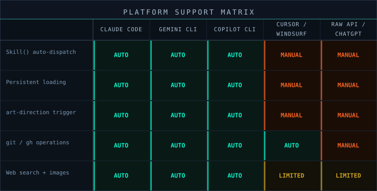

# Adapting auto-spicy-github to Other Platforms

The `art-direction` skill was designed for Claude Code, Gemini CLI, and Copilot CLI. On other platforms you can still run the discovery conversation by supplying the skill text yourself.

*Three native platforms, two manual, one honest account of what you lose.*

---

## Raw API / any capable LLM

Paste `skills/art-direction/SKILL.md` into your system prompt before the conversation starts, then ask the model to establish a visual identity for your repo. It will run the four-question discovery conversation and author `docs/assets/VISUAL-IDENTITY.md`.

`skills/clearwatch-visual-standards/SKILL.md` is a separate, standalone skill for Clearwatch artwork only; paste it the same way when doing Clearwatch work.

---

## Cursor / Windsurf / other IDE agents

1. Create `.cursorrules` (or `.windsurfrules`, or your IDE's equivalent) at your project root
2. Paste the skill file into it
3. Open the repo and ask for a visual identity

`~/.claude/skills/` is not read by IDE agents, so inlining is the only load path. Committing the result needs `git` in the IDE's terminal.

---

## ChatGPT

Paste `skills/art-direction/SKILL.md` into Custom Instructions or the chat and ask the model to run the discovery conversation. ChatGPT cannot run `git`: copy the resulting `VISUAL-IDENTITY.md` into your repo and commit it yourself.

---

## What you lose on non-Claude platforms

| Capability | Claude Code | Other platforms |
|-----------|-------------|-----------------|
| Persistent skill loading | `~/.claude/skills/` | System prompt only |
| Design-skill detection | Scans installed skills | You mention the skill and paste it |
| `git` operations | Native shell access | Run yourself |
