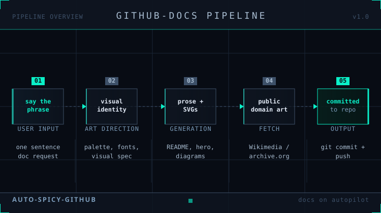

# auto-spicy-github

Give any GitHub repo beautiful, art-directed documentation with a single phrase.


*Five-step pipeline: say the phrase, get art-directed docs committed.*

## What it does

Say `update the github documentation` to Claude Code and it:

- Interviews you about your project's visual personality (4 questions, all optional)
- Establishes a visual identity — palette, typography, imagery style — committed to your repo
- Rewrites every doc page with real examples, second-person voice, zero filler
- Generates SVG diagrams and charts matched to your aesthetic
- Fetches public domain artwork from Wikimedia Commons, the Library of Congress, and the National Archives
- Splits pages over 400 lines into focused topic-driven sub-pages
- Commits everything with a structured message

The docs you are reading right now were produced by this tool.

---

## Install

```bash
git clone https://github.com/petersimmons1972/auto-spicy-github
cd auto-spicy-github
./install.sh
```

Three skills land in `~/.claude/skills/`. They are available immediately in any new Claude Code session.

---

## Use

Open any repo in Claude Code and say:

```
update the github documentation
```

First run: Claude asks about your project's visual personality, commits a `VISUAL-IDENTITY.md`, then runs the full pipeline.

Every run after that: reads the committed identity and goes straight to work.

---

## What gets installed

| Skill | What it does |
|-------|-------------|
| `github-docs` | The documentation refresh pipeline (outcome checklist): audit, prose, SVGs, artwork, commit |
| `art-direction` | Visual identity discovery conversation |
| `visual-output-standards` | SVG and chart craft rules loaded before any visual creation |
| `clearwatch-visual-standards` | Optional Clearwatch overlay: palette, vendor colors and chart constants; load with `visual-output-standards` |

---

## Bring your own design standard

Works best with a design skill installed. [ui-ux-pro-max](https://skills.sh/nextlevelbuilder/ui-ux-pro-max-skill/ui-ux-pro-max) — 50 styles, 21 palettes, 50 font pairings — is the recommended default. Install it and the pipeline detects it automatically, offering its library as a starting point before the discovery questions.

See [docs/design-standards.md](docs/design-standards.md) for the full priority chain.

---

## Platform support

**Native:** Claude Code · Gemini CLI · Copilot CLI

**Other platforms:** [ADAPTING.md](ADAPTING.md) — how to inline the skills into Cursor, ChatGPT, raw API calls, and anywhere else a capable LLM is running.

---

## Requirements

- Claude Code (authenticated)
- Target repo open in a Claude Code session
- GitHub CLI (`gh`) if you want automatic issue filing — optional
