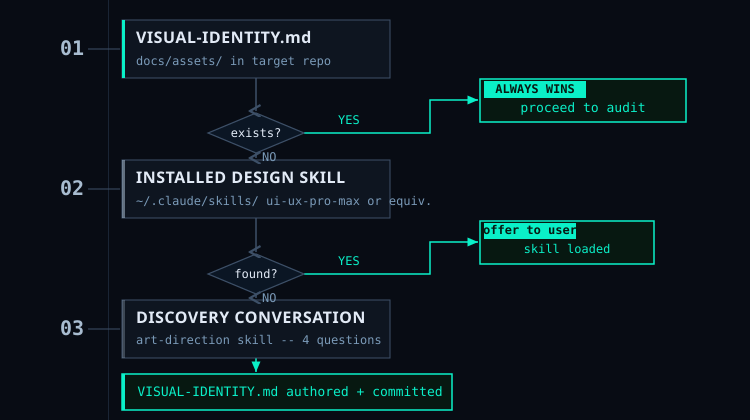

# Design Standards


*VISUAL-IDENTITY.md always wins. Everything else is the path to creating it.*

## How visual standards are resolved

Visual work resolves the standard before creating any asset. The resolution order is fixed:

```
VISUAL-IDENTITY.md (docs/assets/ in the target repo)
  └─ exists? Use it. Proceed with visual work.
     └─ absent?
          ↓
     Installed design skill (~/.claude/skills/)
       └─ found? Offer it. User chooses yes / no / both.
            └─ not found or declined?
                 ↓
            Discovery conversation (art-direction skill)
              └─ 4 questions → VISUAL-IDENTITY.md authored and committed
                   └─ Proceed with visual work.
```

`VISUAL-IDENTITY.md` always wins. If it exists, no questions are asked — visual work reads it and goes. Edit the file to change visual direction. Delete it to re-run the discovery conversation.

---

## What ui-ux-pro-max provides

[ui-ux-pro-max](https://skills.sh/nextlevelbuilder/ui-ux-pro-max-skill/ui-ux-pro-max) is a design intelligence skill from skills.sh:

- **50 named styles** — Swiss International to Brutalist to Cottagecore, each with defined visual rules
- **21 palettes** — purposefully composed, production-tested color systems
- **50 font pairings** — serif/sans, display/body combinations for every register

Without it, the art-direction skill builds a custom palette and type system from your answers. That produces good results. With it, you start from pre-composed options with a known track record — faster to choose, less to specify.

**Recommended if:** you do not have a strong existing visual preference or established brand system.

---

## Installing ui-ux-pro-max

Follow the install instructions at the [skills.sh listing](https://skills.sh/nextlevelbuilder/ui-ux-pro-max-skill/ui-ux-pro-max). The skill lands in `~/.claude/skills/` alongside the auto-spicy-github skills.

Once installed, the `art-direction` skill picks it up automatically in Step 1:

> "I found ui-ux-pro-max installed. Would you like to use it as your visual design reference?"

Options:

- **yes** — pull palette and typography from it as the design foundation
- **no** — skip it and run the discovery conversation from scratch
- **both** — answer the discovery questions, then select the specific style and palette from ui-ux-pro-max that best matches your answers

---

## Bringing your own design standard

Any Claude Code skill with "design", "ui", "ux", or "visual" in its name or description — installed in `~/.claude/skills/` — is detected automatically by the art-direction skill.

If you have a proprietary design system packaged as a Claude Code skill, put it in `~/.claude/skills/` and it will be offered as a reference during visual identity discovery. No registration required.

If multiple matching skills are installed, the art-direction skill lists them all and asks you to choose before continuing.

---

## VISUAL-IDENTITY.md vs. design skills

A design skill is a vocabulary of options. `VISUAL-IDENTITY.md` is the committed decision for this specific repo.

The workflow:
1. Use a design skill (or the discovery conversation) to arrive at specific choices: palette, type system, visual personality
2. Those choices are written into `docs/assets/VISUAL-IDENTITY.md` with concrete hex codes, font names, and SVG constraints
3. From that point, all SVG generation and artwork selection reads from `VISUAL-IDENTITY.md` — not from the design skill

You can uninstall `ui-ux-pro-max` after the art-direction conversation and your visual identity is fully preserved. The design skill is a starting point, not a runtime dependency.
