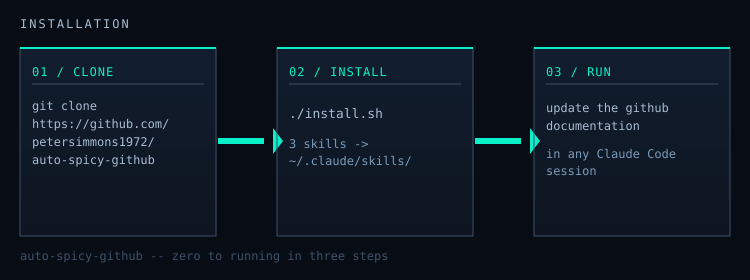

# Getting Started


*Clone, install, say the phrase. That's the full onboarding.*

## Prerequisites

[Claude Code](https://claude.ai/code) — installed and authenticated.

```bash
claude --version
# claude/1.x.x
```

---

## 1. Install

```bash
git clone https://github.com/petersimmons1972/auto-spicy-github
cd auto-spicy-github
./install.sh
```

The installer copies three skills into `~/.claude/skills/`:

```
~/.claude/skills/
  github-docs/            ← the pipeline
  art-direction/          ← visual identity discovery
  visual-output-standards/ ← SVG/chart craft rules
```

Claude Code reads that directory at startup. The skills are live in any new session, no configuration needed.

---

## 2. Open your target repo

```bash
cd ~/projects/your-repo
claude
```

---

## 3. Say the phrase

```
update the github documentation
```

Nothing else. That triggers `github-docs`.

---

## What happens on first run

**If `docs/assets/VISUAL-IDENTITY.md` does not exist** (first time on any repo):

Claude loads the `art-direction` skill and asks you four questions:

1. **Personality** — how should this repo feel? (options provided, or describe it yourself)
2. **Aesthetic reference** — any era, movement, or visual style that resonates? (optional)
3. **Existing brand materials** — logo, hex codes, design system? (optional)
4. **Visual references** — repos or sites whose docs you admire? (optional)

All four are optional. Pressing enter moves forward. Claude authors `VISUAL-IDENTITY.md` from whatever you give it — even a single word — and commits it.

Then the full pipeline runs: audit → prose rewrite → SVG generation → public domain artwork fetch → quality pass → commit.

**On subsequent runs:**

Steps 1–2 are skipped. Claude reads the committed `VISUAL-IDENTITY.md` and goes straight to auditing and updating.

---

## What gets committed

```
docs: your-repo documentation refresh — 2026-04-11

- 4 pages rewritten
- 3 SVGs added: architecture.svg, install-flow.svg, commands.svg
- 2 images fetched: hero.jpg (Wikimedia Commons, PD), contributing.jpg (Library of Congress, PD)
- 0 visual placeholders remaining
- 1 GitHub Issue filed
```

Changes land in `docs/` and the root `README.md`. Nothing outside those paths is touched.

---

## Optional: richer starting palettes

The art-direction skill generates a custom visual identity from your answers. If you want a pre-composed starting point — 50 named styles, 21 palettes, 50 font pairings — install [ui-ux-pro-max](https://skills.sh/nextlevelbuilder/ui-ux-pro-max-skill/ui-ux-pro-max).

Once installed, the art-direction skill detects it automatically and offers it before the discovery questions.

---

## Try it on this repo first

Before running it on something you care about:

```bash
cd ~/path/to/auto-spicy-github
claude
```

```
update the github documentation
```

The docs you are reading right now were produced this way. You will see exactly what the pipeline produces — visual identity conversation, SVG output, prose rewrites, commit log — before it touches anything important.
